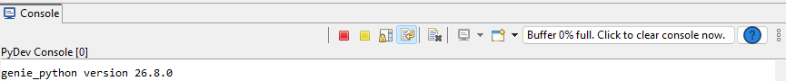
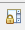

# Scripting View

The Scripting-View displays a Python console, allowing you to load and execute Python or genie_python scripts. **Note**: Scripts running in the Scripting View are independent of scripts running on the Script Server and independent of scripts running in other consoles and clients.

## Multiple Consoles and Views

The IBEX Gui supports both multiple consoles and multiple views on those consoles. You should think of this as multiple versions of genie_python, each running in a console, which you can view through one or many windows. To see how to utilise this read the following toolbar section.

## Tool Bar

The tools bar at the top of every python console view looks like:

From left to right, the buttons are:

-  Stop the whole console. This will stop the current script and remove the console from view, useful if you are running multiple consoles.
-  Interrupt (via {external+python:obj}`KeyboardInterrupt`). This is useful if you realise that the script is doing something wrong. This can also be done by pressing Ctrl+C
-  Toggle scroll-lock, which prevents new console output from scrolling the scripting window. This is useful if you need to inspect or copy from previous script output, without interrupting the script.
-  Toggle word-wrap: with word-wrap disabled, long output lines will cause a horizontal scroll-bar to appear. With this option enabled, long output lines will instead be wrapped onto new lines.
-  Clear the console. This will remove all the text from the window, be careful though as this WON'T stop the current script.
- Switch to a different console. This will be greyed out if you only have one console running.
-  Start a new console or a new view. You can use this to start a new console by selecting "PyDev Console". Be careful: having multiple consoles running control scripts simultaneously will lead to the consoles 'fighting' for control of the instrument.
- Clear the console. This button also displays the current memory usage of all the output in the console.
- Open this help page.
